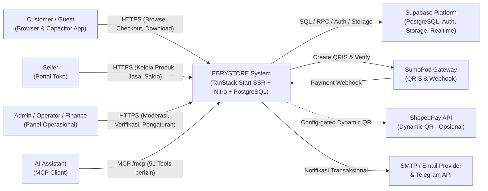
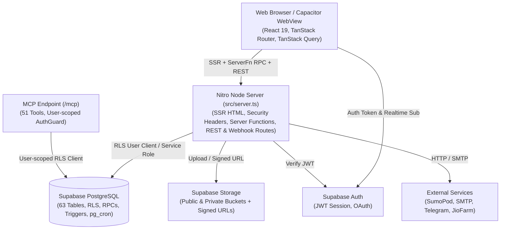

# 02. Current Architecture (As-Is) & Target Architecture (To-Be)

## 3. Current Architecture (As-Is)

### 3.1 Verified Technology Stack (`VERIFIED`)

| Lapisan | Teknologi & Versi (`package.json` / repo) | Status |
|---|---|---|
| **Full-Stack Web Framework** | TanStack Start (`@tanstack/react-start` ^1.169.3), TanStack Router (`^1.170.45`), Nitro | VERIFIED (Aktif) |
| **UI & Styling** | React (`^19.2.0`), TypeScript, Tailwind CSS v4 (`^4.2.1`), Radix UI, Lucide React, Motion (`^13.5.0`) | VERIFIED (Aktif) |
| **Client State & Forms** | TanStack Query (`^5.101.1`), React Hook Form (`^7.71.2`), Zod (`^4.4.3`) | VERIFIED (Aktif) |
| **Backend / BaaS** | Supabase PostgreSQL (63 tabel, RLS, SQL RPC `SECURITY DEFINER`), Supabase Auth, Supabase Storage, Supabase Realtime | VERIFIED (Aktif) |
| **Integrations** | SumoPod API (QRIS), ShopeePay adapter (config-gated), Nodemailer SMTP, Telegram Bot API, JioFarm API, `@lovable.dev/mcp-js` (51 MCP tools) | VERIFIED |
| **Mobile Wrapper** | Capacitor (`@capacitor/core` ^8.6.0, `android/`, `ios/`, `capacitor-shell/`) memuat URL produksi `https://app.ebrystore.my.id` | VERIFIED |
| **Testing & Quality** | Vitest (`vitest run`, 53 file / 665 test), Playwright (`@playwright/test`), ESLint 9, TypeScript `tsc --noEmit`, GitHub Actions CI | VERIFIED |
| **Production Runtime** | Nitro `node-server` (`NITRO_PRESET=node-server`), VPS Ubuntu `43.156.83.235` (`/srv/ebrystore/app`, `systemd` service `ebrystore`) | VERIFIED / USER CONTEXT (`AGENTS.md`) |

### 3.2 Gaya Arsitektur Aktual
EBRYSTORE berjalan sebagai **Modular Monolith berbasis SSR (TanStack Start + Nitro)** yang terhubung langsung ke **Supabase PostgreSQL sebagai Data & Transaction Engine** (`VERIFIED`). Logika bisnis sensitif (pembuatan order, mutasi saldo/ledger, pembayaran, escrow jasa, rate limiting) diletakkan di dalam **PostgreSQL RPC (`SECURITY DEFINER`) dan trigger**, sementara server functions TanStack Start bertindak sebagai lapisan validasi input (Zod), otorisasi (`requireSupabaseAuth` + `assertPermission`), orkestrasi integrasi eksternal, dan SSR.

---

## 4. C4 Architecture Model

### 4.1 Level 1 — System Context

### 4.2 Level 2 — Container Diagram (As-Is)

### 4.3 Level 3 — Component Diagram & Batas Tanggung Jawab

| Komponen / Modul (`src/lib/`) | Tanggung Jawab | Batas & Kontrak Komunikasi |
|---|---|---|
| **Routing & UI Layer** (`src/routes/`, `src/components/`) | Rendering SSR/CSR, form validation UX, navigasi, cache invalidation TanStack Query | Tidak boleh mengakses service-role DB; memanggil server functions atau endpoint `/api/*` |
| **Auth & RBAC Guard** (`src/integrations/supabase/auth-middleware.ts`, `src/lib/authz.server.ts`) | Verifikasi Bearer JWT (`requireSupabaseAuth`), pemeriksaan izin granular (`assertPermission`), audit trail (`writeAudit`) | Wajib dipanggil pada seluruh mutasi admin/operator/seller sensitif |
| **Catalog & Storefront** (`public-catalog.server.ts`, `catalog.functions.ts`, `catalog-api.server.ts`) | Pembacaan katalog publik via anon client + `search_products_fts`, proxy media tervalidasi | Hanya mengembalikan entitas `approved` & `published`; kegagalan query dikembalikan sebagai error eksplisit |
| **Order & Fulfillment** (`orders.functions.ts`, `academic.functions.ts`, `marketplace-service.functions.ts`, `fulfillment.functions.ts`) | Orkestrasi checkout, entitlement/download signed URL, lifecycle jasa & komplain | Kalkulasi harga, stok, dan transisi state dijalankan di PostgreSQL RPC |
| **Payment & Ledger** (`payments.functions.ts`, `sumopod.server.ts`, `shopeepay.server.ts`, `webhook.*.ts`) | Pembuatan QRIS, validasi HMAC/token webhook, verifikasi manual, rekonsiliasi | Browser dilarang mengubah status pembayaran; webhook wajib idempoten |
| **Configuration & Ops** (`website-settings.ts`, `website-settings.server.ts`, `rate-limit.server.ts`, `email-admin.functions.ts`) | Registry 146 key pengaturan, cache publik, rate limiting fail-closed (finansial), dispatch email/Telegram | Field sensitif/readOnly dilindungi; pengaturan dibaca server & SSR |

---

## 5. Target Architecture (To-Be) & Evaluasi Evolusi

### 5.1 Prinsip Target Architecture
Sistem **tetap mempertahankan arsitektur Modular Monolith** (TanStack Start + Nitro `node-server` + Supabase PostgreSQL). Migrasi ke microservices, Redis, atau message broker terpisah **tidak direkomendasikan** pada skala saat ini karena akan menambah kompleksitas operasional tanpa bottleneck terukur (`KISS` & `YAGNI`).

### 5.2 Perbaikan Terstruktur yang Direkomendasikan (To-Be)
1. **Sinkronisasi Skema & Migrasi**: Menerapkan seluruh migrasi lokal tertunda (`20261121132000_*`, `20261121150000_*`, `20261121160000_*`) ke Supabase produksi melalui pipeline terverifikasi.
2. **Observability & Health Probe**: Menambahkan endpoint `/api/health` ringan (cek konektivitas DB tanpa membocorkan detail sensitif) dan structured logging terpusat untuk webhook & cron job.
3. **Konsistensi Konfigurasi Build**: Menyelaraskan dokumentasi `vite.config.ts` dengan target rilis aktual (`NITRO_PRESET=node-server` di VPS).
4. **Pengujian Kontrak SQL-App**: Memperluas integration test terhadap RPC kritikal (`create_digital_order`, `apply_as_seller`, `resolve_service_complaint`) pada environment staging/local Supabase CLI.
