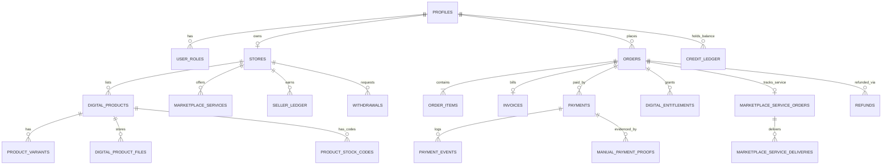

# 07. Database Design & 08. Security Design

## 7. Database Design (`VERIFIED`)

### 7.1 Ringkasan Skema & Domain Tabel (63 Tabel Terverifikasi)
Berdasarkan `src/integrations/supabase/types.ts` dan `supabase/migrations/`, basis data PostgreSQL mencakup domain berikut:
- **Identitas & RBAC**: `profiles`, `user_roles`, `permissions`, `role_permissions`, `audit_logs`.
- **Toko & Katalog**: `stores`, `categories`, `digital_products`, `product_variants`, `digital_product_files`, `product_stock_codes`, `marketplace_services`, `services`, `service_packages`, `service_addons`, `articles`, `article_status_history`.
- **Transaksi, Pembayaran & Kredit**: `orders`, `order_items`, `order_status_histories`, `invoices`, `payments`, `payment_events`, `payment_verifications`, `manual_payment_proofs`, `refunds`, `credit_ledger`, `credit_topups`, `custom_orders`, `po_payments`, `po_messages`.
- **Fulfillment & Eskrow**: `digital_entitlements`, `digital_order_receipts`, `download_logs`, `marketplace_service_orders`, `marketplace_service_deliveries`, `marketplace_service_events`, `operator_assignments`, `service_order_details`, `academic_order_attachments`, `job_progress`, `job_results`, `job_revisions`.
- **Keuangan Seller & Payout**: `seller_ledger`, `seller_bank_accounts`, `withdrawals`, `withdrawal_events`.
- **Interaksi, Analitik & Konfigurasi**: `product_reviews`, `product_likes`, `store_follows`, `product_inquiries`, `product_inquiry_messages`, `notifications`, `admin_tasks`, `campaigns`, `analytics_events`, `analytics_daily`, `seo_audit_results`, `system_settings`, `rate_limit_hits`, `scheduled_job_runs`, `email_dispatch_log`, `telegram_dispatch_log`.

### 7.2 Entity Relationship Diagram (Domain Inti Transaksi & Marketplace)

### 7.3 Strategi Integritas, Konkurensi & RLS (`VERIFIED`)
- **Row Level Security (RLS)**: Aktif pada tabel pengguna, toko, produk, order, dan keuangan. Seller hanya dapat membaca/mengubah baris milik tokonya (`stores.owner_id = auth.uid()`). Trigger dan kolom sensitif (`moderation_status`, `status` toko/produk) dilindungi dari eskalasi langsung oleh seller (`security-h1-h4.test.ts`, `stores-column-grants.test.ts`).
- **Atomicity & Concurrency**:
  - RPC `SECURITY DEFINER` mengunci baris secara eksplisit dengan `FOR UPDATE` / `FOR SHARE` serta memakai **advisory lock dua argumen** (`pg_advisory_xact_lock`) sebelum membaca saldo/mutasi kredit.
  - Job kedaluwarsa memakai `FOR UPDATE SKIP LOCKED` agar eksekusi paralel tidak memproses order yang sama dua kali.
- **Idempotency**: `payments.idempotency_key`, `credit_ledger.idempotency_key`, dan `payment_events` memiliki `UNIQUE` constraint untuk mencegah transaksi ganda atau webhook replay.
- **Pengaturan Dinamis DB**: Fungsi `public.setting_int`, `public.setting_bool`, dan `public.setting_text` (`20261121150000_wire_remaining_admin_settings.sql`) membaca `system_settings` dengan fallback aman.

---

## 8. Security Design (`VERIFIED`)

### 8.1 Authentication & Authorization
- **Session & JWT**: Supabase Auth menerbitkan JWT; klien mengirim `Authorization: Bearer <token>` yang diverifikasi di server oleh `requireSupabaseAuth` (`src/integrations/supabase/auth-middleware.ts`).
- **RBAC Granular**: `assertPermission(ctx, permission)` mengecek relasi `user_roles` → `role_permissions` → `permissions`.
- **MCP Tool Isolation**: Seluruh 51 tool MCP menggunakan `authGuard` dan client RLS terlingkup user (tanpa `supabaseAdmin` bypass pada operasi pengguna).

### 8.2 Application & Transport Security (`src/server.ts`)
- Security headers pada respons SSR HTML & API: `X-Content-Type-Options: nosniff`, `Referrer-Policy: strict-origin-when-cross-origin`, `Strict-Transport-Security`, `X-Frame-Options: SAMEORIGIN`, `Permissions-Policy`, dan `Content-Security-Policy` (di produksi `frame-ancestors 'self'`).
- **Anti-Path Traversal Media Proxy**: `/api/public/catalog-image/$` dan `/api/public/service-media/$` memvalidasi path & menolak `..` atau URL eksternal berbahaya (`marketplace-home.test.tsx`).
- **Guest Review Hardening**: Ulasan tamu wajib masuk antrean moderasi (`is_visible: false`, `is_verified: false`) dan tidak memengaruhi rating toko/produk (`20261121132000_verified_reviews_rating_only.sql`).

### 8.3 Threat Model Ringkas (Domain Kritis)

| Aset / Jalur | Ancaman | Mitigasi Terverifikasi |
|---|---|---|
| **Checkout & Harga** | Manipulasi harga/diskon atau pembelian produk sendiri dari klien | Harga, fee, diskon, dan blokir `SELF_PURCHASE_DENIED` dihitung ulang di PostgreSQL RPC |
| **Webhook Pembayaran** | Pemalsuan callback lunas atau replay webhook | Validasi HMAC/token di `webhook.sumopod.ts` & `webhook.shopeepay.ts`, batas body 64 KB, idempotency DB |
| **Analitik Publik** | Pemalsuan event `payment_success` dari browser / DoS body besar | Event `payment_success` dihapus dari schema publik; batas streaming 4 KB (`track.ts`) |
| **Multi-Vendor Isolation** | Seller A membaca/mengubah produk/order Seller B (IDOR) | RLS berbasis `owner_id`, `my_store_id()`, dan `stores-column-grants` |
| **Secrets Management** | Kebocoran `SUPABASE_SERVICE_ROLE_KEY`, `SUMOPOD_API_KEY`, `VPS_PW` | Server-only env (`*.server.ts`); `SETTINGS_ENCRYPTION_KEY` untuk enkripsi rahasia di `crypto.server.ts` |
