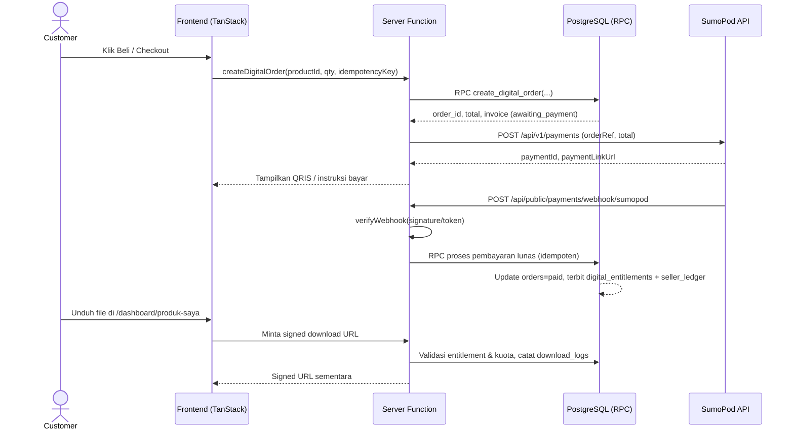
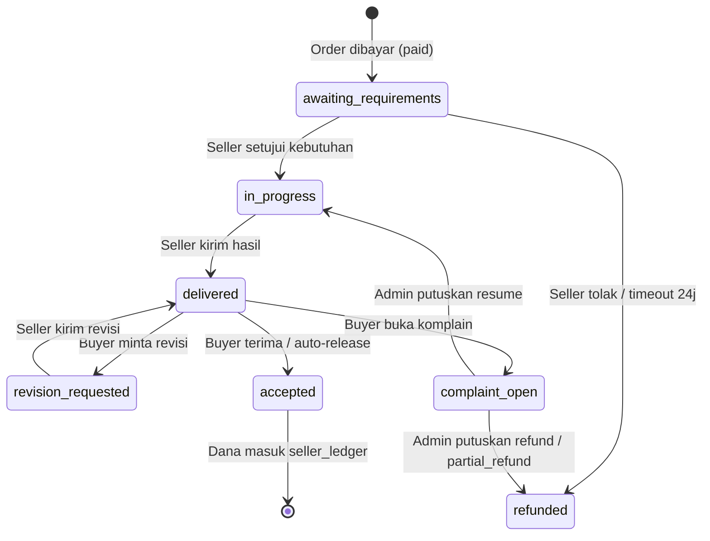

# 09. Integration, 10. Infrastructure & 11. Data Flow & Sequence

## 9. API & Integration Design (`VERIFIED`)

### 9.1 Daftar Endpoint HTTP Terverifikasi

| Endpoint | Method | Autentikasi & Otorisasi | Validasi & Batas | Tujuan |
|---|---|---|---|---|
| `/api/v1/catalog/*` | `GET` | Publik (anon client) | Pagination & filter query | API katalog publik terstruktur (`catalog-api.server.ts`) |
| `/api/public/catalog-image/$` | `GET` | Publik | Path whitelist, anti-traversal | Proxy aman gambar katalog Storage |
| `/api/public/service-media/$` | `GET` | Publik | Path whitelist `service-media/` | Proxy aman media jasa seller |
| `/api/public/og-image/$` | `GET` | Publik | Validasi URL/path | Generasi/proxy gambar OpenGraph |
| `/api/public/analytics/track` | `POST` | Publik (token/session opsional) | Max 4 KB streaming, schema event | Pencatatan `page_view` & event storefront aman |
| `/api/public/payments/webhook/sumopod` | `POST` | HMAC / Webhook Token SumoPod | Max 64 KB, `bodySchema` | Pemrosesan callback pembayaran QRIS SumoPod |
| `/api/public/payments/webhook/shopeepay` | `POST` | Signature ShopeePay (`shopeepay.server.ts`) | Config-gated (`SHOPEEPAY_ENABLED`) | Callback ShopeePay Dynamic QR (opsional) |
| `/api/public/jobs/email-dispatch` | `POST` | `JOBS_CRON_TOKEN` | Header token check | Pengiriman antrean email SMTP |
| `/api/public/jobs/telegram-dispatch` | `POST` | `JOBS_CRON_TOKEN` | Header token check | Pengiriman notifikasi Telegram |
| `/api/public/jobs/shopeepay-reconcile` | `POST` | `JOBS_CRON_TOKEN` | Header token check | Rekonsiliasi status ShopeePay |
| `/mcp` | `POST` / SSE | `authGuard` (user JWT) | User-scoped RLS client | Eksekusi 51 MCP tools berizin |

### 9.2 Integrasi Eksternal
- **SumoPod (`src/lib/sumopod.server.ts`)**: Membuat payment link QRIS (`POST /api/v1/payments`) dengan `SUMOPOD_API_KEY`, mendukung mode `sandbox` & `live`/`production`, durasi expiry mengikuti `qris_expiry_minutes`.
- **ShopeePay (`src/lib/shopeepay.server.ts`)**: Nonaktif secara default (`SHOPEEPAY_ENABLED !== "true"` atau kredensial belum lengkap); saat aktif menggunakan endpoint QR dinamis dan rekonsiliasi terjadwal.
- **SMTP / Email & Telegram**: Diproses via `email-dispatch` & `telegram-dispatch` menggunakan `email_dispatch_log` / `telegram_dispatch_log` agar kegagalan kirim tidak menggagalkan transaksi utama.

---

## 10. Infrastructure & Deployment Design

### 10.1 Runtime & Deployment Aktual (`VERIFIED` + `USER CONTEXT`)
- **Runtime Produksi**: Build Vite + Nitro dengan preset **`node-server`** (`$env:NITRO_PRESET='node-server'; npm run build`) menghasilkan direktori `.output/`.
- **Hosting VPS**: Ubuntu VPS di **`43.156.83.235`** (`USER CONTEXT` di `AGENTS.md`), domain publik **`https://app.ebrystore.my.id`**, service `systemd` bernama **`ebrystore`** berjalan di port lokal `127.0.0.1:3000`.
- **Strategi Rilis Zero-Conflict**:
  - Rilis disimpan per versi di `/srv/ebrystore/releases/<nama>-YYYYMMDD-NN/.output`.
  - Aktivasi atomik lewat symlink `/srv/ebrystore/app/.output` + `systemctl restart ebrystore`.
  - Rollback cepat cukup mengarahkan symlink ke direktori rilis sebelumnya lalu `systemctl restart ebrystore`.
- **Mobile Shell (Capacitor)**: `capacitor.config.ts` mengemas aplikasi native Android/iOS yang memuat `https://app.ebrystore.my.id` dengan fallback lokal `capacitor-shell/index.html`.
- **CI/CD**: `.github/workflows/ci.yml` menjalankan `npm ci`, `npm run typecheck`, `npm run lint`, dan `npm run test:unit` pada setiap push/PR ke `main`.

### 10.2 Perbandingan Alternatif Runtime (`Nitro node-server VPS` vs `Cloudflare Workers`)

| Kriteria | VPS + Nitro `node-server` (Saat Ini) | Cloudflare Workers (Default `vite.config.ts`) |
|---|---|---|
| **Kompatibilitas Library Node** | Penuh (`nodemailer`, `sharp`, `node:crypto`, stream) | Terbatas (butuh polyfill / API non-Node) |
| **Kompleksitas Operasional** | Perlu manajemen VPS, SSL/proxy, backup | Serverless terkelola, nol manajemen OS |
| **Biaya & Prediktabilitas** | Biaya VPS tetap | Pay-per-request |
| **Rekomendasi** | **Pertahankan untuk produksi saat ini** karena ketergantungan pada `nodemailer` & `sharp` | Evaluasi hanya bila seluruh modul email/image dipindah ke HTTP API |

---

## 11. Data Flow & Sequence Design (`VERIFIED`)

### 11.1 Alur Checkout Produk Digital, Pembayaran QRIS & Entitlement

### 11.2 Siklus Status Pesanan Jasa Marketplace (`marketplace_service_orders`)

